# Odoo Git submodule map

> This file is generated by `tools/generate_submodule_map.py`. Do not edit it manually.

> Reviewed 22 October 2026. This map counts Git repository links, not installed modules. Production also contains Celestial Fulfillment and Sales Order Full Addresses as embedded addons; they are not missing from production. The prepared update converts both to standalone links. There are 41 addon modules in each environment.

Repository: [RobertMiller-KR2/Insight](https://github.com/RobertMiller-KR2/Insight)

| Environment | Ref | Submodules |
| --- | --- | ---: |
| Production | `main` | 39 |
| Sandbox | `sandbox` | 41 |

| Same commit | Different commit | Sandbox only | Production only | Configuration problems |
| ---: | ---: | ---: | ---: | ---: |
| 37 | 2 | 2 | 0 | 0 |

```mermaid
flowchart LR
  production["Production (main) · 39"]
  sandbox["Sandbox (sandbox) · 41"]
  p0["barcode_program_operation_cards · 04d4e6a"]
  production --> p0
  s0["barcode_program_operation_cards · 04d4e6a"]
  sandbox --> s0
  p0 -. "same commit" .-> s0
  p1["barcode_silk_zxing_fix · def6bd3"]
  production --> p1
  s1["barcode_silk_zxing_fix · def6bd3"]
  sandbox --> s1
  p1 -. "same commit" .-> s1
  p2["cargo_architect · 090d665"]
  production --> p2
  s2["cargo_architect · 090d665"]
  sandbox --> s2
  p2 -. "same commit" .-> s2
  s3["celestial_3pl_fulfillment · 0d7e793"]
  sandbox --> s3
  p4["celestial_velocity_inventory · 1c8c4f9"]
  production --> p4
  s4["celestial_velocity_inventory · 1c8c4f9"]
  sandbox --> s4
  p4 -. "same commit" .-> s4
  p5["commercial_vehicle_checklist · cea0d1e"]
  production --> p5
  s5["commercial_vehicle_checklist · cea0d1e"]
  sandbox --> s5
  p5 -. "same commit" .-> s5
  p6["company_watermark · d69af17"]
  production --> p6
  s6["company_watermark · d69af17"]
  sandbox --> s6
  p6 -. "same commit" .-> s6
  p7["contact_import_assistant · f41d30d"]
  production --> p7
  s7["contact_import_assistant · f41d30d"]
  sandbox --> s7
  p7 -. "same commit" .-> s7
  p8["custom_receipts_and_reports · d14a11b"]
  production --> p8
  s8["custom_receipts_and_reports · d14a11b"]
  sandbox --> s8
  p8 -. "same commit" .-> s8
  p9["customer_balance_statements · 16078be"]
  production --> p9
  s9["customer_balance_statements · 16078be"]
  sandbox --> s9
  p9 -. "same commit" .-> s9
  p10["customer_blanket_orders · f1f8d4c"]
  production --> p10
  s10["customer_blanket_orders · f1f8d4c"]
  sandbox --> s10
  p10 -. "same commit" .-> s10
  p11["customer_blanket_orders_enterprise · df8094a"]
  production --> p11
  s11["customer_blanket_orders_enterprise · df8094a"]
  sandbox --> s11
  p11 -. "same commit" .-> s11
  p12["customer_quantity_forecast · a464ffa"]
  production --> p12
  s12["customer_quantity_forecast · a464ffa"]
  sandbox --> s12
  p12 -. "same commit" .-> s12
  p13["daily_received_items_report · 8792e1c"]
  production --> p13
  s13["daily_received_items_report · 8792e1c"]
  sandbox --> s13
  p13 -. "same commit" .-> s13
  p14["dynamic_sandbox_systray · a807115"]
  production --> p14
  s14["dynamic_sandbox_systray · a807115"]
  sandbox --> s14
  p14 -. "same commit" .-> s14
  p15["field_label_duplicate_fixer · 79d8dd5"]
  production --> p15
  s15["field_label_duplicate_fixer · 79d8dd5"]
  sandbox --> s15
  p15 -. "same commit" .-> s15
  p16["free_product_program_portal · ccde6db"]
  production --> p16
  s16["free_product_program_portal · ccde6db"]
  sandbox --> s16
  p16 -. "same commit" .-> s16
  p17["gratis_box_builder · 2fbe3eb"]
  production --> p17
  s17["gratis_box_builder · 2fbe3eb"]
  sandbox --> s17
  p17 -. "same commit" .-> s17
  p18["inventory_multi_location_relocator · 872056a"]
  production --> p18
  s18["inventory_multi_location_relocator · 872056a"]
  sandbox --> s18
  p18 -. "same commit" .-> s18
  p19["invoice_aging_group · b82a03c"]
  production --> p19
  s19["invoice_aging_group · b82a03c"]
  sandbox --> s19
  p19 -. "same commit" .-> s19
  p20["kr2_chatter_resize · d62ce22"]
  production --> p20
  s20["kr2_chatter_resize · d62ce22"]
  sandbox --> s20
  p20 -. "same commit" .-> s20
  p21["odoo_qz_sato_label · c30ee0e"]
  production --> p21
  s21["odoo_qz_sato_label · c30ee0e"]
  sandbox --> s21
  p21 -. "same commit" .-> s21
  p22["print_list_view · 50545d9"]
  production --> p22
  s22["print_list_view · 50545d9"]
  sandbox --> s22
  p22 -. "same commit" .-> s22
  p23["product_barcode_brand_lookup · ecf22f9"]
  production --> p23
  s23["product_barcode_brand_lookup · ecf22f9"]
  sandbox --> s23
  p23 -. "same commit" .-> s23
  p24["product_inventory_quick_report · e7bda34"]
  production --> p24
  s24["product_inventory_quick_report · e7bda34"]
  sandbox --> s24
  p24 -. "same commit" .-> s24
  p25["product_on_order_column · 081f1f8"]
  production --> p25
  s25["product_on_order_column · 081f1f8"]
  sandbox --> s25
  p25 -. "same commit" .-> s25
  p26["program_builder · 9f86d56"]
  production --> p26
  s26["program_builder · 9436f0e"]
  sandbox --> s26
  p26 -. "different commit" .-> s26
  p27["quickbooks_po_import · 19b348f"]
  production --> p27
  s27["quickbooks_po_import · 19b348f"]
  sandbox --> s27
  p27 -. "same commit" .-> s27
  p28["receipt_count_sheet · 064e351"]
  production --> p28
  s28["receipt_count_sheet · 064e351"]
  sandbox --> s28
  p28 -. "same commit" .-> s28
  p29["receipt_price_confirmation · a3b2996"]
  production --> p29
  s29["receipt_price_confirmation · a3b2996"]
  sandbox --> s29
  p29 -. "same commit" .-> s29
  s30["sale_order_full_addresses · 55e5f7d"]
  sandbox --> s30
  p31["sales_tax_liability_state · 67e6129"]
  production --> p31
  s31["sales_tax_liability_state · 67e6129"]
  sandbox --> s31
  p31 -. "same commit" .-> s31
  p32["shipment_proof · 0692435"]
  production --> p32
  s32["shipment_proof · 0692435"]
  sandbox --> s32
  p32 -. "same commit" .-> s32
  p33["user_app_icon_visibility · 4f6f735"]
  production --> p33
  s33["user_app_icon_visibility · 4f6f735"]
  sandbox --> s33
  p33 -. "same commit" .-> s33
  p34["warehouse_location_map · 6e50f69"]
  production --> p34
  s34["warehouse_location_map · 6e50f69"]
  sandbox --> s34
  p34 -. "same commit" .-> s34
  p35["warehouse_location_pick_routing · c3e5786"]
  production --> p35
  s35["warehouse_location_pick_routing · c3e5786"]
  sandbox --> s35
  p35 -. "same commit" .-> s35
  p36["warehouse_operations_dashboard_pro · 83defc6"]
  production --> p36
  s36["warehouse_operations_dashboard_pro · 83defc6"]
  sandbox --> s36
  p36 -. "same commit" .-> s36
  p37["warehouse_shipment · 5a262a4"]
  production --> p37
  s37["warehouse_shipment · cda5c8e"]
  sandbox --> s37
  p37 -. "different commit" .-> s37
  p38["website_shortcut_manager · f158ef7"]
  production --> p38
  s38["website_shortcut_manager · f158ef7"]
  sandbox --> s38
  p38 -. "same commit" .-> s38
  p39["weekly_received_items_report · d44330a"]
  production --> p39
  s39["weekly_received_items_report · d44330a"]
  sandbox --> s39
  p39 -. "same commit" .-> s39
  p40["woo_commerce_order_import · df7b0c4"]
  production --> p40
  s40["woo_commerce_order_import · df7b0c4"]
  sandbox --> s40
  p40 -. "same commit" .-> s40
```



## Exact comparison

| Submodule path | Production commit | Sandbox commit | Status | Repository |
| --- | --- | --- | --- | --- |
| `barcode_program_operation_cards` | [`04d4e6a`](https://github.com/RobertMiller-KR2/barcode-program-operation-cards/commit/04d4e6a26193a977c7b036a2b5b3eb5f0f29691c) | [`04d4e6a`](https://github.com/RobertMiller-KR2/barcode-program-operation-cards/commit/04d4e6a26193a977c7b036a2b5b3eb5f0f29691c) | Same commit | [RobertMiller-KR2/barcode-program-operation-cards](https://github.com/RobertMiller-KR2/barcode-program-operation-cards) |
| `barcode_silk_zxing_fix` | [`def6bd3`](https://github.com/RobertMiller-KR2/barcode-silk-zxing-fix/commit/def6bd3c9985efbba8bb7e3cf8ecbd67fdee2eb8) | [`def6bd3`](https://github.com/RobertMiller-KR2/barcode-silk-zxing-fix/commit/def6bd3c9985efbba8bb7e3cf8ecbd67fdee2eb8) | Same commit | [RobertMiller-KR2/barcode-silk-zxing-fix](https://github.com/RobertMiller-KR2/barcode-silk-zxing-fix) |
| `cargo_architect` | [`090d665`](https://github.com/RobertMiller-KR2/Cargo-Architect/commit/090d6658668b8a940894f54fd18e9882e2e9a2c0) | [`090d665`](https://github.com/RobertMiller-KR2/Cargo-Architect/commit/090d6658668b8a940894f54fd18e9882e2e9a2c0) | Same commit | [RobertMiller-KR2/Cargo-Architect](https://github.com/RobertMiller-KR2/Cargo-Architect) |
| `celestial_3pl_fulfillment` | — | [`0d7e793`](https://github.com/RobertMiller-KR2/celestial-3pl-fulfillment/commit/0d7e793fb733a8e6856e2c9bb98d21b78ad4dcc5) | Sandbox only | [RobertMiller-KR2/celestial-3pl-fulfillment](https://github.com/RobertMiller-KR2/celestial-3pl-fulfillment) |
| `celestial_velocity_inventory` | [`1c8c4f9`](https://github.com/RobertMiller-KR2/celestial-velocity-inventory/commit/1c8c4f9f62e4586f7fd12f7db22a23f78c988e7b) | [`1c8c4f9`](https://github.com/RobertMiller-KR2/celestial-velocity-inventory/commit/1c8c4f9f62e4586f7fd12f7db22a23f78c988e7b) | Same commit | [RobertMiller-KR2/celestial-velocity-inventory](https://github.com/RobertMiller-KR2/celestial-velocity-inventory) |
| `commercial_vehicle_checklist` | [`cea0d1e`](https://github.com/RobertMiller-KR2/Commercial-Vehicle-Checklist/commit/cea0d1ee4bb3ee8e98063ecd62cfb238f835ebde) | [`cea0d1e`](https://github.com/RobertMiller-KR2/Commercial-Vehicle-Checklist/commit/cea0d1ee4bb3ee8e98063ecd62cfb238f835ebde) | Same commit | [RobertMiller-KR2/Commercial-Vehicle-Checklist](https://github.com/RobertMiller-KR2/Commercial-Vehicle-Checklist) |
| `company_watermark` | [`d69af17`](https://github.com/RobertMiller-KR2/company-watermark/commit/d69af177dfe85cb22333238f09cff2096edde09c) | [`d69af17`](https://github.com/RobertMiller-KR2/company-watermark/commit/d69af177dfe85cb22333238f09cff2096edde09c) | Same commit | [RobertMiller-KR2/company-watermark](https://github.com/RobertMiller-KR2/company-watermark) |
| `contact_import_assistant` | [`f41d30d`](https://github.com/RobertMiller-KR2/Contact-Data-Management-Pro/commit/f41d30dcb1ba54a82b735c17d520f5717ef22280) | [`f41d30d`](https://github.com/RobertMiller-KR2/Contact-Data-Management-Pro/commit/f41d30dcb1ba54a82b735c17d520f5717ef22280) | Same commit | [RobertMiller-KR2/Contact-Data-Management-Pro](https://github.com/RobertMiller-KR2/Contact-Data-Management-Pro) |
| `custom_receipts_and_reports` | [`d14a11b`](https://github.com/RobertMiller-KR2/custom-receipts-and-reports/commit/d14a11bf3bcd07b58f0f04c3ef1a1a0ee0aa201a) | [`d14a11b`](https://github.com/RobertMiller-KR2/custom-receipts-and-reports/commit/d14a11bf3bcd07b58f0f04c3ef1a1a0ee0aa201a) | Same commit | [RobertMiller-KR2/custom-receipts-and-reports](https://github.com/RobertMiller-KR2/custom-receipts-and-reports) |
| `customer_balance_statements` | [`16078be`](https://github.com/RobertMiller-KR2/customer-balance-statements/commit/16078beeed2614f2126fcdcf279f8b0f4db55872) | [`16078be`](https://github.com/RobertMiller-KR2/customer-balance-statements/commit/16078beeed2614f2126fcdcf279f8b0f4db55872) | Same commit | [RobertMiller-KR2/customer-balance-statements](https://github.com/RobertMiller-KR2/customer-balance-statements) |
| `customer_blanket_orders` | [`f1f8d4c`](https://github.com/RobertMiller-KR2/odoo19-customer-blanket-orders/commit/f1f8d4c424e0e6843c2ad92ab85ebfe56866573c) | [`f1f8d4c`](https://github.com/RobertMiller-KR2/odoo19-customer-blanket-orders/commit/f1f8d4c424e0e6843c2ad92ab85ebfe56866573c) | Same commit | [RobertMiller-KR2/odoo19-customer-blanket-orders](https://github.com/RobertMiller-KR2/odoo19-customer-blanket-orders) |
| `customer_blanket_orders_enterprise` | [`df8094a`](https://github.com/RobertMiller-KR2/odoo19-customer-blanket-orders-Enterprise_Addon/commit/df8094af8f45bfa6d6b15a767ecb11ff69fd8aed) | [`df8094a`](https://github.com/RobertMiller-KR2/odoo19-customer-blanket-orders-Enterprise_Addon/commit/df8094af8f45bfa6d6b15a767ecb11ff69fd8aed) | Same commit | [RobertMiller-KR2/odoo19-customer-blanket-orders-Enterprise_Addon](https://github.com/RobertMiller-KR2/odoo19-customer-blanket-orders-Enterprise_Addon) |
| `customer_quantity_forecast` | [`a464ffa`](https://github.com/RobertMiller-KR2/customer-quantity-forecast/commit/a464ffa1365f2c42383ea6f6ab2e7e03f98e2e97) | [`a464ffa`](https://github.com/RobertMiller-KR2/customer-quantity-forecast/commit/a464ffa1365f2c42383ea6f6ab2e7e03f98e2e97) | Same commit | [RobertMiller-KR2/customer-quantity-forecast](https://github.com/RobertMiller-KR2/customer-quantity-forecast) |
| `daily_received_items_report` | [`8792e1c`](https://github.com/RobertMiller-KR2/daily-received-items-report/commit/8792e1c28d7b8442b4ec338c01ae3fdb59b34404) | [`8792e1c`](https://github.com/RobertMiller-KR2/daily-received-items-report/commit/8792e1c28d7b8442b4ec338c01ae3fdb59b34404) | Same commit | [RobertMiller-KR2/daily-received-items-report](https://github.com/RobertMiller-KR2/daily-received-items-report) |
| `dynamic_sandbox_systray` | [`a807115`](https://github.com/RobertMiller-KR2/dynamic-sandbox-systray/commit/a807115b2ed1f680705fc47cd91213cb6911b493) | [`a807115`](https://github.com/RobertMiller-KR2/dynamic-sandbox-systray/commit/a807115b2ed1f680705fc47cd91213cb6911b493) | Same commit | [RobertMiller-KR2/dynamic-sandbox-systray](https://github.com/RobertMiller-KR2/dynamic-sandbox-systray) |
| `field_label_duplicate_fixer` | [`79d8dd5`](https://github.com/RobertMiller-KR2/field-label-duplicate-fixer/commit/79d8dd5ee010ea84bb07c8d5377deef6897597d1) | [`79d8dd5`](https://github.com/RobertMiller-KR2/field-label-duplicate-fixer/commit/79d8dd5ee010ea84bb07c8d5377deef6897597d1) | Same commit | [RobertMiller-KR2/field-label-duplicate-fixer](https://github.com/RobertMiller-KR2/field-label-duplicate-fixer) |
| `free_product_program_portal` | [`ccde6db`](https://github.com/RobertMiller-KR2/free-product-program-portal/commit/ccde6db679b6aba472574242de9eade8d08df58d) | [`ccde6db`](https://github.com/RobertMiller-KR2/free-product-program-portal/commit/ccde6db679b6aba472574242de9eade8d08df58d) | Same commit | [RobertMiller-KR2/free-product-program-portal](https://github.com/RobertMiller-KR2/free-product-program-portal) |
| `gratis_box_builder` | [`2fbe3eb`](https://github.com/RobertMiller-KR2/gratis-box-builder/commit/2fbe3ebeaa68847e4dcced590f4b44442aeea9e5) | [`2fbe3eb`](https://github.com/RobertMiller-KR2/gratis-box-builder/commit/2fbe3ebeaa68847e4dcced590f4b44442aeea9e5) | Same commit | [RobertMiller-KR2/gratis-box-builder](https://github.com/RobertMiller-KR2/gratis-box-builder) |
| `inventory_multi_location_relocator` | [`872056a`](https://github.com/RobertMiller-KR2/inventory-multi-location-relocator/commit/872056a304005f56b6d2ba617bd9617a82f9474f) | [`872056a`](https://github.com/RobertMiller-KR2/inventory-multi-location-relocator/commit/872056a304005f56b6d2ba617bd9617a82f9474f) | Same commit | [RobertMiller-KR2/inventory-multi-location-relocator](https://github.com/RobertMiller-KR2/inventory-multi-location-relocator) |
| `invoice_aging_group` | [`b82a03c`](https://github.com/RobertMiller-KR2/invoice-aging-group/commit/b82a03cf7d892c060e93a96a2147503712a04bd6) | [`b82a03c`](https://github.com/RobertMiller-KR2/invoice-aging-group/commit/b82a03cf7d892c060e93a96a2147503712a04bd6) | Same commit | [RobertMiller-KR2/invoice-aging-group](https://github.com/RobertMiller-KR2/invoice-aging-group) |
| `kr2_chatter_resize` | [`d62ce22`](https://github.com/RobertMiller-KR2/kr2-chatter-resize/commit/d62ce22812e7425afdf0f696cd092a343db3aae4) | [`d62ce22`](https://github.com/RobertMiller-KR2/kr2-chatter-resize/commit/d62ce22812e7425afdf0f696cd092a343db3aae4) | Same commit | [RobertMiller-KR2/kr2-chatter-resize](https://github.com/RobertMiller-KR2/kr2-chatter-resize) |
| `odoo_qz_sato_label` | [`c30ee0e`](https://github.com/RobertMiller-KR2/odoo-qz-sato-label/commit/c30ee0e94789833271ba9ac2578eec3d13865e9c) | [`c30ee0e`](https://github.com/RobertMiller-KR2/odoo-qz-sato-label/commit/c30ee0e94789833271ba9ac2578eec3d13865e9c) | Same commit | [RobertMiller-KR2/odoo-qz-sato-label](https://github.com/RobertMiller-KR2/odoo-qz-sato-label) |
| `print_list_view` | [`50545d9`](https://github.com/RobertMiller-KR2/print-list-view/commit/50545d94b4ffea4b3d23023a342213b54f185341) | [`50545d9`](https://github.com/RobertMiller-KR2/print-list-view/commit/50545d94b4ffea4b3d23023a342213b54f185341) | Same commit | [RobertMiller-KR2/print-list-view](https://github.com/RobertMiller-KR2/print-list-view) |
| `product_barcode_brand_lookup` | [`ecf22f9`](https://github.com/RobertMiller-KR2/product-barcode-brand-lookup/commit/ecf22f9b2668ac5edca9739d81472f6e39fdcfe0) | [`ecf22f9`](https://github.com/RobertMiller-KR2/product-barcode-brand-lookup/commit/ecf22f9b2668ac5edca9739d81472f6e39fdcfe0) | Same commit | [RobertMiller-KR2/product-barcode-brand-lookup](https://github.com/RobertMiller-KR2/product-barcode-brand-lookup) |
| `product_inventory_quick_report` | [`e7bda34`](https://github.com/RobertMiller-KR2/product-inventory-quick-report/commit/e7bda3406ad227834ad662c1939bd17225ff1df8) | [`e7bda34`](https://github.com/RobertMiller-KR2/product-inventory-quick-report/commit/e7bda3406ad227834ad662c1939bd17225ff1df8) | Same commit | [RobertMiller-KR2/product-inventory-quick-report](https://github.com/RobertMiller-KR2/product-inventory-quick-report) |
| `product_on_order_column` | [`081f1f8`](https://github.com/RobertMiller-KR2/product-on-order-column/commit/081f1f8b86ed7bca78d800b1ff4aa8ee14c54f42) | [`081f1f8`](https://github.com/RobertMiller-KR2/product-on-order-column/commit/081f1f8b86ed7bca78d800b1ff4aa8ee14c54f42) | Same commit | [RobertMiller-KR2/product-on-order-column](https://github.com/RobertMiller-KR2/product-on-order-column) |
| `program_builder` | [`9f86d56`](https://github.com/RobertMiller-KR2/program-builder/commit/9f86d5683a27c4aef9afd4060dde09dfb638d517) | [`9436f0e`](https://github.com/RobertMiller-KR2/program-builder/commit/9436f0ecce5811c4ba62cda53106a2d8a00b0d5c) | Different commit | [RobertMiller-KR2/program-builder](https://github.com/RobertMiller-KR2/program-builder) |
| `quickbooks_po_import` | [`19b348f`](https://github.com/RobertMiller-KR2/po-import-wizard/commit/19b348f5cd04f0c02603438b1b9f2f7823b59586) | [`19b348f`](https://github.com/RobertMiller-KR2/po-import-wizard/commit/19b348f5cd04f0c02603438b1b9f2f7823b59586) | Same commit | [RobertMiller-KR2/po-import-wizard](https://github.com/RobertMiller-KR2/po-import-wizard) |
| `receipt_count_sheet` | [`064e351`](https://github.com/RobertMiller-KR2/receipt-count-sheet/commit/064e351188f6eec94047db684ae8e1a79c7f40a1) | [`064e351`](https://github.com/RobertMiller-KR2/receipt-count-sheet/commit/064e351188f6eec94047db684ae8e1a79c7f40a1) | Same commit | [RobertMiller-KR2/receipt-count-sheet](https://github.com/RobertMiller-KR2/receipt-count-sheet) |
| `receipt_price_confirmation` | [`a3b2996`](https://github.com/RobertMiller-KR2/receipt-price-confirmation/commit/a3b2996ebacba311ca86f9efb9fc3da3c34aeedf) | [`a3b2996`](https://github.com/RobertMiller-KR2/receipt-price-confirmation/commit/a3b2996ebacba311ca86f9efb9fc3da3c34aeedf) | Same commit | [RobertMiller-KR2/receipt-price-confirmation](https://github.com/RobertMiller-KR2/receipt-price-confirmation) |
| `sale_order_full_addresses` | — | [`55e5f7d`](https://github.com/RobertMiller-KR2/sale-order-full-addresses/commit/55e5f7d4db9302717f4a436a62160ec2870ef3be) | Sandbox only | [RobertMiller-KR2/sale-order-full-addresses](https://github.com/RobertMiller-KR2/sale-order-full-addresses) |
| `sales_tax_liability_state` | [`67e6129`](https://github.com/RobertMiller-KR2/sales-tax-liability-state/commit/67e6129f47bde1418d5a626b5acd39f5f0b25c8d) | [`67e6129`](https://github.com/RobertMiller-KR2/sales-tax-liability-state/commit/67e6129f47bde1418d5a626b5acd39f5f0b25c8d) | Same commit | [RobertMiller-KR2/sales-tax-liability-state](https://github.com/RobertMiller-KR2/sales-tax-liability-state) |
| `shipment_proof` | [`0692435`](https://github.com/RobertMiller-KR2/shipment-proof/commit/06924359468813abad8b1bde9306a0f33e76dc4b) | [`0692435`](https://github.com/RobertMiller-KR2/shipment-proof/commit/06924359468813abad8b1bde9306a0f33e76dc4b) | Same commit | [RobertMiller-KR2/shipment-proof](https://github.com/RobertMiller-KR2/shipment-proof) |
| `user_app_icon_visibility` | [`4f6f735`](https://github.com/RobertMiller-KR2/user_app_icon_visibility/commit/4f6f7353b6b5767944b9e38983d4f2f569a9638f) | [`4f6f735`](https://github.com/RobertMiller-KR2/user_app_icon_visibility/commit/4f6f7353b6b5767944b9e38983d4f2f569a9638f) | Same commit | [RobertMiller-KR2/user_app_icon_visibility](https://github.com/RobertMiller-KR2/user_app_icon_visibility) |
| `warehouse_location_map` | [`6e50f69`](https://github.com/RobertMiller-KR2/warehouse-location-map/commit/6e50f6969a112a96311536c6c6c604322931de6f) | [`6e50f69`](https://github.com/RobertMiller-KR2/warehouse-location-map/commit/6e50f6969a112a96311536c6c6c604322931de6f) | Same commit | [RobertMiller-KR2/warehouse-location-map](https://github.com/RobertMiller-KR2/warehouse-location-map) |
| `warehouse_location_pick_routing` | [`c3e5786`](https://github.com/RobertMiller-KR2/warehouse-location-pick-routing/commit/c3e578679e3974c507b6f838c7980b0450f1704e) | [`c3e5786`](https://github.com/RobertMiller-KR2/warehouse-location-pick-routing/commit/c3e578679e3974c507b6f838c7980b0450f1704e) | Same commit | [RobertMiller-KR2/warehouse-location-pick-routing](https://github.com/RobertMiller-KR2/warehouse-location-pick-routing) |
| `warehouse_operations_dashboard_pro` | [`83defc6`](https://github.com/RobertMiller-KR2/warehouse-operations-dashboard-pro/commit/83defc6d2bce313aa018f33d01fa26c742bc6c1d) | [`83defc6`](https://github.com/RobertMiller-KR2/warehouse-operations-dashboard-pro/commit/83defc6d2bce313aa018f33d01fa26c742bc6c1d) | Same commit | [RobertMiller-KR2/warehouse-operations-dashboard-pro](https://github.com/RobertMiller-KR2/warehouse-operations-dashboard-pro) |
| `warehouse_shipment` | [`5a262a4`](https://github.com/RobertMiller-KR2/warehouse-shipment/commit/5a262a437d9576ed1106c585e00913466a7e3d61) | [`cda5c8e`](https://github.com/RobertMiller-KR2/warehouse-shipment/commit/cda5c8e2c51e19d7cb0ef4d9590e1f959a07887b) | Different commit | [RobertMiller-KR2/warehouse-shipment](https://github.com/RobertMiller-KR2/warehouse-shipment) |
| `website_shortcut_manager` | [`f158ef7`](https://github.com/RobertMiller-KR2/website-shortcut-manager/commit/f158ef7161cdf9dabeb2df8ca24e062934c637a4) | [`f158ef7`](https://github.com/RobertMiller-KR2/website-shortcut-manager/commit/f158ef7161cdf9dabeb2df8ca24e062934c637a4) | Same commit | [RobertMiller-KR2/website-shortcut-manager](https://github.com/RobertMiller-KR2/website-shortcut-manager) |
| `weekly_received_items_report` | [`d44330a`](https://github.com/RobertMiller-KR2/weekly-received-items-report/commit/d44330aadd4bbd6b878e26ab792c6bcc7e8c156f) | [`d44330a`](https://github.com/RobertMiller-KR2/weekly-received-items-report/commit/d44330aadd4bbd6b878e26ab792c6bcc7e8c156f) | Same commit | [RobertMiller-KR2/weekly-received-items-report](https://github.com/RobertMiller-KR2/weekly-received-items-report) |
| `woo_commerce_order_import` | [`df7b0c4`](https://github.com/RobertMiller-KR2/woo-commerce-order-import/commit/df7b0c4233103ee09278a1b2c43eb7be4e707432) | [`df7b0c4`](https://github.com/RobertMiller-KR2/woo-commerce-order-import/commit/df7b0c4233103ee09278a1b2c43eb7be4e707432) | Same commit | [RobertMiller-KR2/woo-commerce-order-import](https://github.com/RobertMiller-KR2/woo-commerce-order-import) |

## Refresh locally

```bash
git fetch origin main sandbox
python3 tools/generate_submodule_map.py \
  --production-ref origin/main \
  --sandbox-ref origin/sandbox \
  --repository-url https://github.com/RobertMiller-KR2/Insight
```
